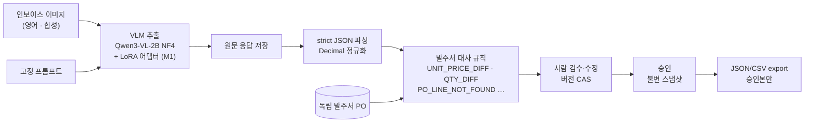
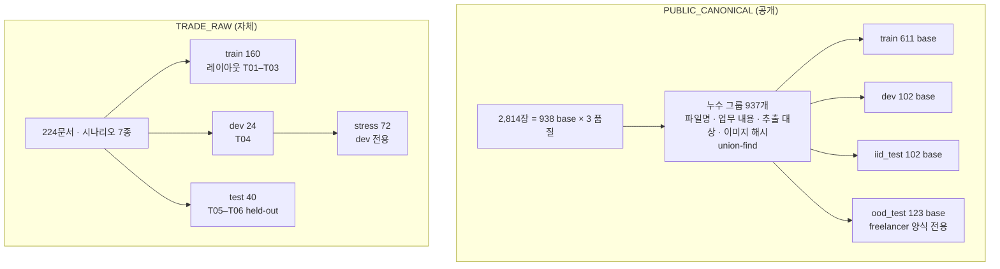
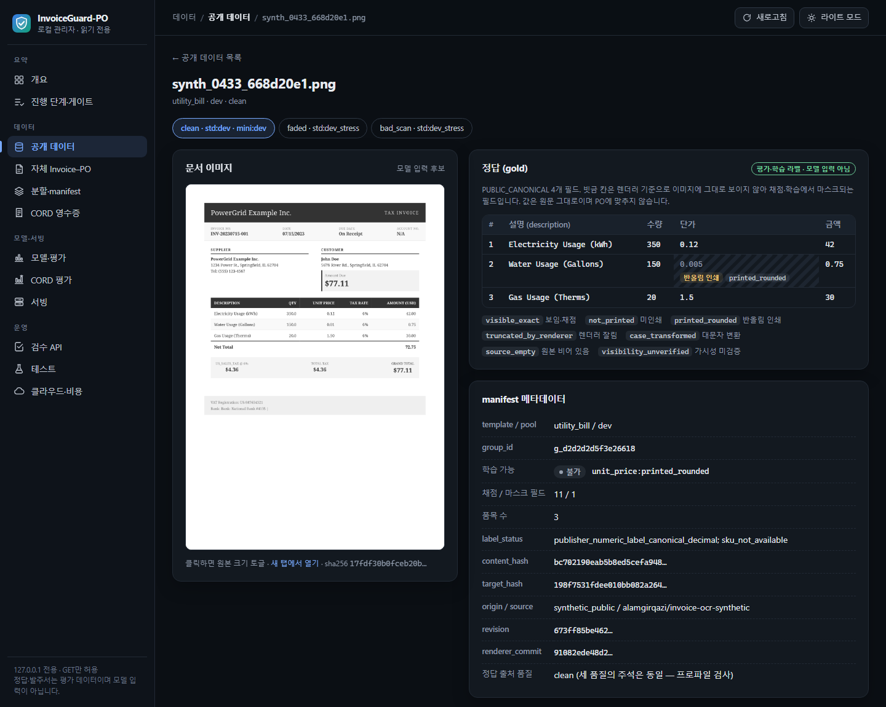
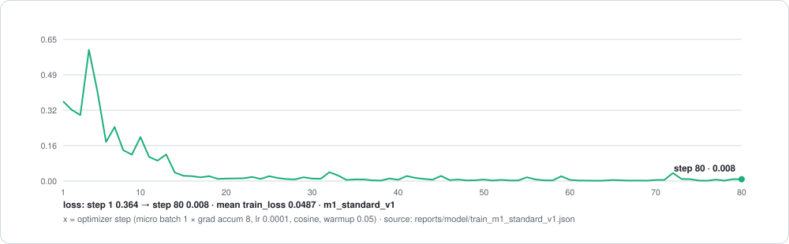
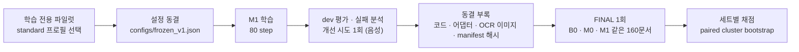
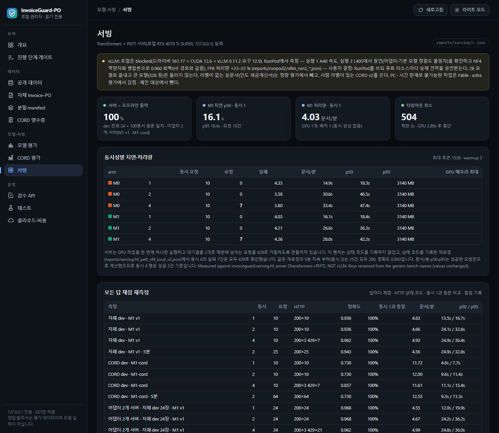
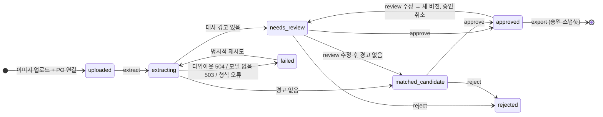
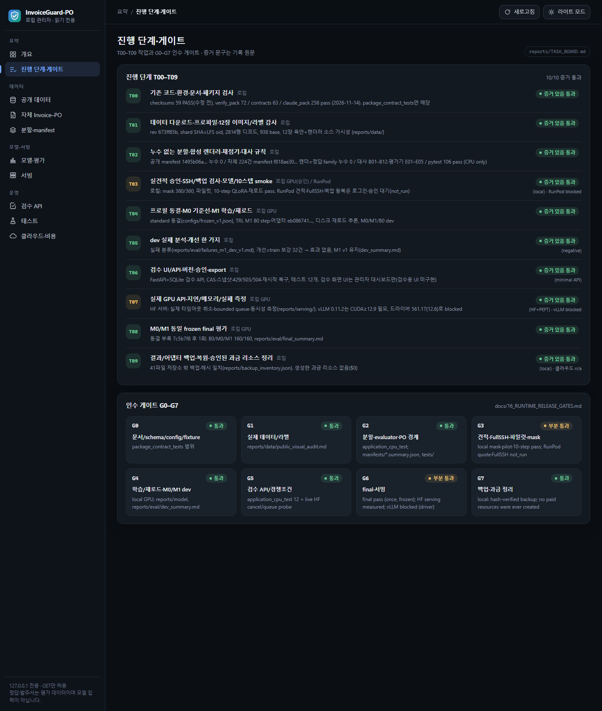

# InvoiceGuard-PO

**영어 인보이스 이미지 → VLM 추출(Qwen3-VL-2B + QLoRA) → 독립 발주서(PO) 대사 → 사람 검수·승인 → 승인본만 export**

[](https://github.com/TaeyanG4/invoiceguard-po/actions/workflows/ci.yml)


데이터는 **모두 합성**(공개 InvoiceOCR-Synth + 자체 생성 Invoice–PO)이며 실제 기업·통관 문서 성능을 주장하지 않습니다. 평가 수치(학습·dev·final·paired CI)는 이 저장소의 스크립트로 재현되고, 실행하지 않은 항목은 `not_run`/`blocked`로 남겼습니다.


<sub>로컬 관리자 대시보드(읽기 전용, 127.0.0.1)의 개요 화면. 화면의 모든 값은 `reports/`·`manifests/`의 기록을 그대로 읽은 것입니다. "10/10"은 증거가 있는 단계 수이며, T03·T07은 로컬 부분만 통과했습니다(RunPod·vLLM은 blocked).</sub>

## 목차
1. [한눈에 보기](#1-한눈에-보기)
2. [시스템 구성](#2-시스템-구성)
3. [데이터](#3-데이터)
4. [모델과 학습](#4-모델과-학습)
5. [평가 설계](#5-평가-설계)
6. [결과](#6-결과)
7. [서빙](#7-서빙)
8. [검수 API](#8-검수-api)
9. [관리자 대시보드](#9-관리자-대시보드)
10. [직무 역량 ↔ 증거](#10-직무-역량--증거)
11. [비용과 한계](#11-비용과-한계)
12. [재현](#12-재현)
13. [출처](#13-출처)

---

## 1. 한눈에 보기

| | B0 OCR + 규칙 | M0 Qwen3-VL-2B 기본 | **M1 QLoRA** |
|---|---:|---:|---:|
| 자체 test — 학습에 없던 레이아웃 (40문서) | 0.210 | 0.897 | **0.921** (M1−M0 유의하지 않음) |
| 공개 IID clean (20) | 0.731 | 0.000 ¹ | **0.880** (M1−B0 유의하지 않음) |
| 공개 IID bad_scan (20) | 0.346 | 0.000 ¹ | **0.798** |
| 공개 OOD(freelancer) clean (20) | 0.000 ² | 0.000 ¹ | **0.973** |

<sub>strict 필드 정확도, FINAL(설정 동결 후 1회). ¹ M0는 공개 세트에서 출력을 ```` ```json ```` 펜스로 감싸 strict JSON 유효율이 0/120 — 형식 실패입니다(아래 lenient 참고). ² B0의 0점은 held-out 양식의 헤더 단어를 규칙에서 일부러 제외한(v1.2) 결과입니다.</sub>

<picture>
  <source media="(prefers-color-scheme: dark)" srcset="docs/images/final-accuracy-dark.svg">
  
</picture>

**읽는 법 — 정직한 결론**
1. **B0가 본 레이아웃의 깨끗한 문서는 OCR + 규칙으로도 충분**합니다. 공개 IID clean/faded와 dev clean에서 M1−B0 차이가 유의하지 않고(final IID clean +0.149 [−0.15, 0.42]), 같은 세트의 **문서 완전일치는 오히려 B0가 높습니다**(IID clean 0.80 vs M1 0.65).
2. **OCR 규칙은 처음 보는 레이아웃·열화에서 무너지고, 파인튜닝한 VLM은 버팁니다.** 자체 test(미학습 레이아웃) M1−B0 **+0.711 [0.67, 0.75]**, dev 열화 3종 +0.71~+0.81, final IID bad_scan +0.452 [0.21, 0.69].
3. **파인튜닝 이득의 상당 부분은 "출력 형식"입니다.** 펜스만 벗긴 M0 lenient 점수는 IID clean 0.817, 나머지 0.00–0.56. 자체 test에서 M1−M0 = +0.024 [−0.001, 0.050]로 **유의하지 않음**.
4. **남은 위험:** M1은 모호수량 문서 2건 모두에서 수량을 숫자로 바꿨고(AMBIGUOUS_QUANTITY 리콜 **0/2**, M0는 1/2), 추출 오류로 인한 **오경보가 많습니다**(UNIT_PRICE_DIFF FP 15, LINE_ARITHMETIC_MISMATCH FP 19). 그래서 제품은 모든 문서를 사람 검수로 보냅니다. dev 기반 개선 시도(학습 데이터 보강)는 효과가 없었고 그대로 기록했습니다.

---

## 2. 시스템 구성



- **모델 입력은 (고정 프롬프트, 이미지)뿐**입니다. 발주서·정답·파일명·시나리오 ID는 모델에 들어가지 않습니다.
- LLM은 VLM 내부의 언어모델뿐입니다. 대사·승인은 결정적 규칙이며 챗봇·RAG는 없습니다.
- 모델: [`Qwen/Qwen3-VL-2B-Instruct`](https://huggingface.co/Qwen/Qwen3-VL-2B-Instruct) @ `89644892`, M1 어댑터 SHA256 `eb086741…`.

| 구성 요소 | 코드 |
|---|---|
| 데이터·분할·합성 렌더러 | [`public_manifest.py`](src/invoiceguard/public_manifest.py), [`splits.py`](src/invoiceguard/splits.py), [`synth/`](src/invoiceguard/synth) |
| 학습·추론 (HF Transformers + PEFT + TRL) | [`vlm/train.py`](src/invoiceguard/vlm/train.py), [`vlm/infer.py`](src/invoiceguard/vlm/infer.py) |
| OCR 기준선 B0 (Tesseract, Docker) | [`ocr_baseline.py`](src/invoiceguard/ocr_baseline.py) |
| 채점·비교·동결 | [`evaluation.py`](src/invoiceguard/evaluation.py), [`score_run.py`](src/invoiceguard/score_run.py), [`compare_runs.py`](src/invoiceguard/compare_runs.py), [`freeze.py`](src/invoiceguard/freeze.py) |
| 대사 규칙 | [`reconciliation.py`](src/invoiceguard/reconciliation.py) |
| GPU 서빙 서버 | [`serving/hf_server.py`](src/invoiceguard/serving/hf_server.py) |
| 검수 API | [`app/api.py`](src/invoiceguard/app/api.py) |
| 관리자 대시보드 | [`dashboard_server.py`](src/invoiceguard/dashboard_server.py), [`dashboard_static/`](src/invoiceguard/dashboard_static) |

---

## 3. 데이터

| 종류 | 출처 | 규모 | 정답(라벨) | 용도 |
|---|---|---|---|---|
| **PUBLIC_CANONICAL** | [InvoiceOCR-Synth](https://huggingface.co/datasets/alamgirqazi/invoice-ocr-synthetic) rev `673ff85b` (CC BY 4.0, 합성 영어) | 2,814장 = 938 base × 3 품질 (clean · faded · bad_scan), 템플릿 6종 | 품목 설명·수량·단가·금액(숫자 canonical). **SKU 정답 없음** | 학습 · dev · final(IID/OOD) |
| **TRADE_RAW** | 자체 합성 Invoice–PO (가상 회사) | 224문서, 레이아웃 6종, 시나리오 7종 | 렌더러가 그린 원문 문자열 그대로 (SKU·단위 포함) + 독립 발주서 | 학습 · dev · final(test) |
| **stress (dev 전용)** | 자체 dev 24장 × 열화 3종 | 72장 (blur+JPEG · fade+noise · skew+저해상도) | TRADE_RAW와 동일 | dev 견고성 확인만, final 미포함 |

시나리오 7종: `normal` · `price_change` · `quantity_change` · `unknown_sku` · `ambiguous_quantity` · `missing_po_line` · `duplicate_sku`.



- **가시성 마스크:** 공개 데이터는 렌더러 소스로 필드가 이미지에 그대로 보이는지 판정했습니다. 인쇄되지 않은 단가·대문자 변환·28자 절단·반올림 인쇄는 채점과 학습에서 제외합니다([`reports/data/`](reports/data)).
- **standard 프로필**(학습 전용 파일럿으로 선택 후 동결): 학습 이미지 200장, dev 20 + dev_stress 16, final은 IID 20 base × 3 품질과 OOD 20 base × 3 품질. IID 풀에는 학습에 없는 `event_ticket` 템플릿도 들어 있습니다.
- **자체 데이터 생성:** 발주서를 먼저 만들고 시나리오에 따라 값을 유지·변경해 인보이스를 렌더합니다. 정답 문자열만 그리며, 렌더=정답·겹침·열 침범을 자동 검사합니다. 프롬프트 주입 문구가 든 견고성 문서도 일부 포함합니다.

| 공개 데이터 상세 (bad_scan, 반올림 인쇄 마스크) | 자체 Invoice–PO 상세 (단가 변경 → `UNIT_PRICE_DIFF`) |
|---|---|
|  |  |

<sub>왼쪽 문서 이미지는 InvoiceOCR-Synth의 합성 이미지(<a href="https://creativecommons.org/licenses/by/4.0/">CC BY 4.0</a>)를 대시보드 화면 안에 축소해 표시한 것입니다. 오른쪽은 이 저장소의 렌더러가 만든 가상 회사 문서입니다.</sub>

---

## 4. 모델과 학습

| 항목 | 값 |
|---|---|
| 기본 모델 | Qwen3-VL-2B-Instruct, NF4 double-quant · bf16 compute, 비전 인코더와 lm_head는 비양자화 |
| 방법 | QLoRA SFT — TRL `SFTTrainer` + 검증한 completion-only collator |
| LoRA | r 8 · α 16 · dropout 0.05 · **언어 모델 q_proj/v_proj만** · 학습 파라미터 1,605,632 (전체의 0.11%) |
| 학습 데이터 | 360건 (PUBLIC_CANONICAL 200 + TRADE_RAW 160) |
| 최적화 | 80 optimizer step (micro batch 1 × grad accum 8, ≈1.78 epoch), lr 1e-4 cosine, warmup 0.05 |
| 자원 | 로컬 RTX 4070 Ti SUPER 16GB · 21.8분 · 최대 VRAM 6.52GB |
| 학습 전 검증 | 확장 이미지 토큰 기준 loss mask 감사 360/360, 10-step smoke(유한 gradient · 112/112 텐서 변경 · 저장·재로드 일치) |

<picture>
  <source media="(prefers-color-scheme: dark)" srcset="docs/images/training-loss-dark.svg">
  
</picture>

추가 발견: 이 Windows 스택에서는 비전 patch-embedding Conv3d(bf16)가 문서당 18.4초를 차지했습니다. 그 층만 fp32로 계산하도록 바꿔 추론이 2.5–3배 빨라졌고, 모든 arm에 똑같이 적용했습니다. 기록: [`reports/model/`](reports/model).

---

## 5. 평가 설계



- **공정성:** M0와 M1은 같은 NF4 로딩·프롬프트·이미지 전처리·생성 설정(greedy, batch 1)·문서·분모·채점기를 씁니다. B0도 같은 문서와 채점기를 씁니다.
- **FINAL은 한 번만:** 코드·어댑터·OCR 이미지·manifest 해시를 동결한 뒤 실행했고, 해시가 다르거나 작업 트리가 더러우면 실행을 거부합니다. 누락·실패 문서는 분모에 남깁니다.

| 지표 | 정의 |
|---|---|
| strict 필드 정확도 | strict JSON 파싱 → 정규화 후 필드 단위 일치율. 파싱 실패 문서의 필드는 모두 오답 |
| lenient 정확도 | strict JSON이 실패한 출력에서 코드펜스를 벗긴 뒤 채점 (형식과 읽기 능력을 분리) |
| 문서 exact | 한 문서의 모든 채점 필드가 맞은 비율 |
| 95% CI | base(공개) / family(자체) 단위 cluster bootstrap |
| paired 차이 | 같은 문서 쌍의 A−B, CI가 0을 포함하면 유의하지 않음 |

전체 계약: [`reports/eval/metric_contract_v2.md`](reports/eval/metric_contract_v2.md).

---

## 6. 결과

### FINAL — 세트별 strict 필드 정확도 [95% CI]

| 세트 (n) | B0 OCR + 규칙 | M0 Qwen3-VL-2B | **M1 QLoRA** |
|---|---|---|---|
| 자체 test, 학습에 없던 레이아웃 T05/T06 (40) | 0.210 [0.19–0.23] | 0.897 [0.85–0.94] | **0.921** [0.87–0.96] |
| 공개 IID clean (20) | 0.731 [0.46–0.99] | 0.000 (lenient 0.817) | **0.880** [0.78–0.96] |
| 공개 IID faded (20) | 0.721 [0.45–0.98] | 0.000 (lenient 0.529) | **0.851** [0.69–0.95] |
| 공개 IID bad_scan (20) | 0.346 [0.15–0.56] | 0.000 (lenient 0.466) | **0.798** [0.63–0.92] |
| 공개 OOD freelancer clean (20) | 0.000 ² | 0.000 (lenient 0.555) | **0.973** [0.94–0.99] |
| 공개 OOD freelancer faded (20) | 0.000 ² | 0.000 (lenient 0.000) | **0.905** [0.83–0.96] |
| 공개 OOD freelancer bad_scan (20) | 0.000 ² | 0.000 (lenient 0.058) | **0.756** [0.62–0.88] |

<sub>"OOD"는 같은 합성 생성기에서 학습에서 뺀 템플릿 1종(freelancer)입니다. 분포가 완전히 다른 데이터가 아니며, M1은 오히려 IID clean보다 높습니다. ² B0의 0점은 held-out 양식의 헤더 단어를 규칙에서 일부러 제외한(v1.2) 결과입니다. 원본: [`reports/eval/final_summary.md`](reports/eval/final_summary.md)</sub>

### Paired 차이 (같은 문서, A − B)

<picture>
  <source media="(prefers-color-scheme: dark)" srcset="docs/images/paired-diff-dark.svg">
  
</picture>

- 자체 test에서 **M1−M0 = +0.024 [−0.001, 0.050], 유의하지 않음.** 미학습 레이아웃에서는 기본 VLM도 이미 강합니다.
- 공개 IID clean/faded에서 **M1−B0는 유의하지 않음.** OCR + 규칙이 본 레이아웃의 깨끗한 문서에서는 경쟁력이 있습니다.

### 대사 경고 품질 (자체 test 40문서, 각 arm의 추출로 돌린 대사 vs 정답 기준 대사)

| arm | 검수 대상 비율 | UNIT_PRICE_DIFF TP/FP/FN | QTY_DIFF | AMBIGUOUS_QUANTITY | LINE_ARITHMETIC_MISMATCH |
|---|---:|---|---|---|---|
| B0 | 1.00 | 0 / 0 / 10 | 0 / 0 / 6 | 0 / 85 / 2 | 0 / 0 / 0 |
| M0 | 0.65 | 10 / 13 / 0 | 5 / 1 / 1 | 1 / 0 / 1 | 0 / 18 / 0 |
| M1 | 0.675 | 10 / 15 / 0 | 5 / 2 / 1 | **0 / 0 / 2** | 0 / 19 / 0 |

dev 단계 결과와 실패 분류: [`reports/eval/dev_summary.md`](reports/eval/dev_summary.md), [`reports/eval/failures_m1_dev_v1.md`](reports/eval/failures_m1_dev_v1.md).

---

## 7. 서빙

**Transformers + PEFT GPU 서버** ([`serving/hf_server.py`](src/invoiceguard/serving/hf_server.py)) — OpenAI 호환 subset, 127.0.0.1 전용, GPU 작업자 1 + 대기열 2.

| 측정 (자체 dev 10장, warmup 3) | 결과 |
|---|---|
| 서버 출력 = 오프라인 평가 출력 | M0·M1 모두 원문 100% 동일, 같은 프롬프트 토큰(1045) |
| 처리량 · 지연 (M1) | 동시 1: 4.0 문서/분, p50 16.1s / p95 18.4s · 동시 2: 4.2 문서/분, p50 26.6s / p95 36.3s (직렬 작업자라 대기 시간이 늘어남, 배치 효과 아님) |
| 동시 4 | 10건 중 7건 실패 기록. 대기열 초과 429로 추정되지만 벤치가 상태 코드를 저장하지 않아 미확인(별도 probe에서 동시 4건 → 200·200·200·429 확인) |
| 실제 타임아웃 취소 | 3초 제한 요청 → 3.1초에 504, 직후 작업자 `busy:false` (StoppingCriteria로 생성 중단, 고아 추론 없음) |
| GPU 메모리 | 약 3.1GB (nvidia-smi, 다른 프로세스 포함) |
| LIVE 종단 시연 | 검수 API(LIVE_MODEL) → 추출 15.2s, `UNIT_PRICE_DIFF` 검출, 정답 행과 일치 → 승인 → 스냅샷 export |

**vLLM: blocked.** `vllm/vllm-openai:v0.11.2`(Qwen3-VL 지원 버전)는 CUDA ≥ 12.9를 요구하고 로컬 드라이버 561.17은 CUDA 12.6까지입니다. 요구 조건 검사를 끄고 시도해도 컨테이너 안 PyTorch가 "No CUDA GPUs are available"로 실패했습니다. 드라이버 업데이트와 클라우드 GPU를 쓰지 않기로 결정했으므로 vLLM 속도·양자화 정확도는 주장하지 않습니다. 벤치 스크립트는 준비되어 있습니다: [`serving/vllm_bench.py`](src/invoiceguard/serving/vllm_bench.py).



---

## 8. 검수 API

FastAPI + SQLite ([`app/api.py`](src/invoiceguard/app/api.py)). 사람이 승인한 버전만 내보내고, 늦게 도착한 추론이 최신 수정·승인을 덮어쓰지 못하게 합니다.



<sub>다이어그램은 주요 흐름만 그렸습니다. reject는 `extracting`이 아닌 모든 상태에서 가능하고, 재추출은 `approved`를 뺀 상태(`needs_review`·`matched_candidate`·`rejected`·`failed`)에서 가능하며, 수정 결과는 대사 경고 유무에 따라 `needs_review` 또는 `matched_candidate`가 됩니다.</sub>

- **버전 CAS:** 추출·수정·승인은 모두 `expected_version`을 확인합니다. 추출 완료 시 (버전, run_id, 상태)를 다시 확인해, 그 사이 바뀐 케이스에는 결과를 기록만 하고 반영하지 않습니다.
- **추론 1개씩:** 동시 추출 요청은 429, 추출 중 수정·승인은 409, 타임아웃이 나면 백엔드를 격리(503)하고 health check가 통과하면 풉니다.
- **불변 스냅샷:** 승인 시 스냅샷과 SHA256을 저장하고, export는 현재 버전의 유효한 승인 스냅샷만 돌려줍니다. 재시작하면 `extracting`에 남은 케이스는 `failed/INTERRUPTED`로 바뀝니다.
- 검수용 **화면 UI는 아직 없습니다**. API와 테스트 12개, LIVE 종단 시연 기록만 있습니다.

---

## 9. 관리자 대시보드

로컬 전용 읽기 전용 대시보드(127.0.0.1, GET만 허용, 외부 리소스 없음, 엄격한 CSP). 기본 다크 모드이며 라이트 모드로 바꿀 수 있습니다. 화면의 수치는 모두 저장소 기록을 그대로 읽으며 추정하지 않습니다.

```bash
.venv/Scripts/python.exe -m invoiceguard.dashboard_server --port 8765   # http://127.0.0.1:8765
```

| 그룹 | 페이지 | 내용 |
|---|---|---|
| 요약 | 개요 · 진행 단계·게이트 | 파이프라인 단계, KPI, FINAL 막대, 차단 항목 / T00–T09, G0–G7 |
| 데이터 | 공개 데이터 · 자체 Invoice–PO · 분할·manifest | 필터 목록 → 이미지 + 정답 + 가시성 마스크 / 이미지 + 정답 + 발주서 + 대사 결과 / 분할 통계 |
| 모델·서빙 | 모델·평가 · 서빙 | B0·M0·M1 막대(95% CI·lenient), paired 차이, 학습 loss / 지연·처리량·취소·출력 동일성 |
| 운영 | 검수 API · 테스트 · 클라우드·비용 | T06 기록과 LIVE 시연 / pytest 요약 / 예산 계획과 승인 양식 |

| 모델·평가 | 진행 단계·게이트 |
|---|---|
|  |  |

---

## 10. 직무 역량 ↔ 증거

| 역량 | 이 저장소의 증거 |
|---|---|
| LoRA/QLoRA/SFT, HF transformers·peft·**trl** | [`vlm/train.py`](src/invoiceguard/vlm/train.py) TRL `SFTTrainer` + 검증 collator, NF4 + LoRA r8, [`reports/model/train_m1_standard_v1.json`](reports/model/train_m1_standard_v1.json) |
| 학습 정확성 검증 | loss mask 감사 360/360, 10-step smoke, 재로드 일치 [`reports/model/`](reports/model) |
| 추출 정확도 · 실패 분석 · 개선 | 세트별 평가기 · paired bootstrap, 실패 분류, 개선 1건과 **음성 결과** [`reports/eval/`](reports/eval) |
| 자동 채점 · 회귀 테스트 | pytest 160개 이상(규칙 B01–B12, 평가 E01–E05, API A01–A08, 대시보드), [GitHub Actions CI](.github/workflows/ci.yml), 동결·해시 가드 |
| 서빙 · 성능 측정 | Transformers + PEFT GPU 서버 — 실제 타임아웃 취소 · bounded queue 실측 [`reports/serving/`](reports/serving). vLLM은 blocked |
| OCR / 문서 AI | Tesseract 기준선 B0 (train/dev만 보고 만든 일반 규칙, Docker 격리) |
| 표 구조 문서 · 도메인 규칙 | 구조가 다른 6개 인보이스 레이아웃 렌더러, PO 대사 규칙 |
| 서비스 연동 | 검수 API: 추출 CAS, 늦은 응답 덮어쓰기 방지, 승인 스냅샷 export |

---

## 11. 비용과 한계

**비용:** 클라우드 지출 **$0**. RunPod은 사용하지 않았습니다(사용자 결정). 학습 1회 약 22분, final M0·M1 추론 약 49분(B0 OCR 시간은 기록 없음), 모두 로컬 GPU.

**한계**
- 합성 데이터만 사용했고 표본이 작습니다(공개 세트당 20 base, 자체 test 40, 코드별 사례 1–10건). 열화 stress는 dev 전용입니다.
- M0의 낮은 strict 점수는 형식 효과가 큽니다. 모호수량 실패는 해결되지 않았습니다.
- 서빙: 서빙 프레임워크(vLLM) 미측정(blocked), 양자화 비교 없음(NF4 단일), 배칭 없음(batch 1, 직렬 작업자), 벤치는 문서 10장 · 반복 1회, 서빙 서버 자체의 자동 테스트는 없고 수동 probe만 있습니다.
- 클라우드 GPU 운영·비용 증거는 not_run입니다. FSDP/DeepSpeed는 2B · 단일 GPU에서 필요가 없어 쓰지 않았습니다([`docs/19_DECISIONS_V5.md`](docs/19_DECISIONS_V5.md)).
- 검수 **화면 UI는 미구현**입니다(검수 API와 읽기 전용 관리자 대시보드만 있음).
- 방향 판단과 단계별 검토는 Fable, 구현은 Opus(Claude Code)로 진행했습니다. 중간 검토가 찾은 B0의 held-out 어휘 오염 등은 수정하고 공개했습니다([`reports/IMPLEMENTATION_STATUS.md`](reports/IMPLEMENTATION_STATUS.md)).

---

## 12. 재현

```bash
# 0) 제품/평가 환경 (CPU)
uv venv --python 3.11 .venv && uv pip install --python .venv/Scripts/python.exe -e ".[dev,app]"
.venv/Scripts/python.exe -m pytest tests/
# 1) 데이터: 공개 데이터는 HF에서 rev 673ff85b 의 parquet 2개를 data/raw/invoice-ocr-synthetic/<rev>/data/ 로 내려받은 뒤
.venv/Scripts/python.exe -m invoiceguard.public_profile && .venv/Scripts/python.exe -m invoiceguard.public_manifest
.venv/Scripts/python.exe -m invoiceguard.synth.build && .venv/Scripts/python.exe -m invoiceguard.vlm.stress build
# 2) 모델 환경(.venv-ml): 정확한 버전은 requirements-ml.lock.txt (torch 2.9.1+cu126, transformers 4.57.6, peft 0.17.1, trl 0.25.1, bitsandbytes 0.48.2)
#    모델: Qwen/Qwen3-VL-2B-Instruct @ 89644892 를 models/qwen3-vl-2b-instruct/<rev>/ 에
.venv-ml/Scripts/python.exe -m invoiceguard.vlm.smoke masks
.venv-ml/Scripts/python.exe -m invoiceguard.vlm.train --profile standard --run-id m1_standard_v1
# 3) B0 OCR (Docker): 이미지 빌드 후 OCR -> 예측
docker build -t invoiceguard-ocr:tesseract docker/ocr
.venv/Scripts/python.exe -m invoiceguard.ocr_baseline ocr --set trade:dev --set public:dev --psm 4
.venv/Scripts/python.exe -m invoiceguard.ocr_baseline predict --set trade:dev --set public:dev --psm 4 --run-id b0_dev
# 4) 추론(원문 먼저 저장) -> 채점 -> paired 비교
.venv-ml/Scripts/python.exe -m invoiceguard.vlm.infer --arm m1 --adapter artifacts/adapters/m1_standard_v1 --set trade:dev --set public:dev --run-id m1_dev
.venv/Scripts/python.exe -m invoiceguard.score_run artifacts/predictions/m1_dev
.venv/Scripts/python.exe -m invoiceguard.compare_runs m1_dev b0_dev
# 5) final: 코드 커밋 -> 동결 부록 기록·커밋 -> --allow-final (해시 불일치·dirty tree면 거부)
.venv/Scripts/python.exe -m invoiceguard.freeze write
.venv-ml/Scripts/python.exe -m invoiceguard.vlm.infer --arm m1 --adapter artifacts/adapters/m1_standard_v1 --set public:iid_final --set public:ood_final --set trade:test --run-id m1_final --allow-final
.venv/Scripts/python.exe -m invoiceguard.score_run artifacts/predictions/m1_final --allow-final
# 6) 서빙·검수 API·대시보드 (127.0.0.1)
.venv-ml/Scripts/python.exe -m invoiceguard.serving.hf_server --adapter artifacts/adapters/m1_standard_v1 --port 8001
.venv/Scripts/python.exe -m invoiceguard.serving.vllm_bench run --label hf_peft_nf4_local --port 8001 --conc 1,2,4 --docs 10 --reps 1
.venv/Scripts/python.exe -m invoiceguard.app.server --mode live --model-url http://127.0.0.1:8001 --model m1
.venv/Scripts/python.exe -m invoiceguard.dashboard_server --port 8765
# 7) README 차트 다시 그리기 (reports/의 기록에서 생성)
.venv/Scripts/python.exe -m invoiceguard.readme_figures
```

원래 패키지 안내(Claude Code 시작 방법 · 설계 문서 목록)는 [`docs/PACKAGE_README_v4.md`](docs/PACKAGE_README_v4.md)에 있습니다.

---

## 13. 출처

- 공개 데이터: [alamgirqazi/invoice-ocr-synthetic](https://huggingface.co/datasets/alamgirqazi/invoice-ocr-synthetic), [CC BY 4.0](https://creativecommons.org/licenses/by/4.0/). README의 공개 데이터 화면 캡처(`docs/images/dashboard-public-doc.png`)에 이 데이터셋의 합성 이미지 1장(`synth_0433_668d20e1.png`, bad_scan)이 대시보드 화면 안에 축소되어 들어 있습니다. 데이터 자체는 저장소에 포함하지 않습니다.
- 기본 모델: [Qwen/Qwen3-VL-2B-Instruct](https://huggingface.co/Qwen/Qwen3-VL-2B-Instruct) — 가중치는 저장소에 포함하지 않습니다.
- OCR: [Tesseract](https://github.com/tesseract-ocr/tesseract) 4.1.1 (Docker 이미지 안에서 실행).
