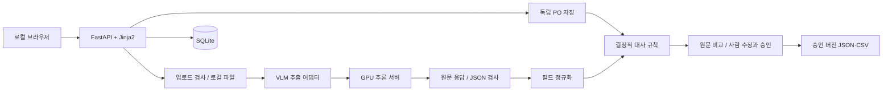

# 03. 시스템 설계

## 1. 단순한 모듈형 구조



추출 모델은 PO 값을 보지 않는다. 이 경계는 단순 아키텍처 취향이 아니라, 문서를 실제로 읽었는지 검증하기 위한 조건이다.

## 2. 구성요소

| 모듈 | 책임 | 하지 않는 일 |
|---|---|---|
| `datasets` | InvoiceOCR-Synth (영어) 변환, 합성 렌더링, manifest와 split | 평가셋 라벨을 서비스 prompt에 넣지 않음 |
| `extraction` | 고정 prompt, VLM adapter, JSON 구문·계약 검사 | PO에 맞게 읽은 숫자를 보정하지 않음 |
| `normalization` | 원문에서 지원하는 숫자·통화를 보수적으로 파싱 | 단위 환산/환율/빈 값 계산 추정 금지 |
| `reconciliation` | PO와 현재 문서 버전 대사 | 모델 self-confidence로 승인하지 않음 |
| `review` | 수정·차이 확인·버전별 승인 | raw model response 덮어쓰기 금지 |
| `evaluation` | 고정 지표/오류 분류/보고서 | 사람이 수정한 값을 모델 예측으로 채점하지 않음 |
| `api` / `web` | 로컬 사용자 작업 흐름 | SaaS/멀티테넌트 인증 제공 안 함 |

## 3. 기술 선택

기본 Python 3.11, FastAPI, Jinja2/최소 JS, SQLite, 로컬 파일. 학습은 RunPod Pod의 PyTorch+Transformers+PEFT/TRL이며 추론은 우선 **Transformers+PEFT 실제 GPU API**로 연결한다. vLLM은 지원 및 어댑터 로드가 실제 확인되면 선택 실험으로 추가한다. 한 사용자의 로컬 PC GPU는 16GB이므로 로컬에서 클라우드 학습이 성공했다고 가정하지 않는다. [S05, S06]

학습환경과 서빙환경을 분리할 수 있다. `requirements-train.lock`, `requirements-serve.lock` 또는 uv lock group은 **실제 성공한 버전으로** 생성한다. 처음부터 최신 버전을 무조건 한 환경에 설치하지 않는다.

## 4. 처리 모델

2일 MVP는 별도 분산 큐 없이 동기 추출 HTTP 요청을 사용한다. 이미지와 PO를 먼저 등록하고 `/extract` 호출이 완료되면 결과를 받는다. 서버는 inference semaphore=1로 제한하며 대기열이 가득 차면 429를 반환한다. 동시성2는 직렬 worker의 대기/거절 동작일 수 있으므로 GPU 병렬화 효과로 부르지 않는다. vLLM 배치 실험은 P1이다.

모델 오류/timeout 후 `failed`와 원인을 저장한다. 프로세스 재시작 시 `extracting`에 남아 있던 건은 `failed/INTERRUPTED`로 전환한다. 무한 재시도는 하지 않으며 사용자에 의한 재실행만 허용한다. 동일 모델 버전의 원문 응답은 실행별로 보존한다.

## 5. 상태 머신

```text
uploaded → extracting → needs_review | matched_candidate | failed
needs_review / matched_candidate → approved | rejected
수정 / PO 재연결 / 모델 재추출 → 승인 무효 → needs_review 또는 matched_candidate
approved → 현재 승인 버전 export 가능
failed → 명시적 재시도 → extracting
```

`matched_candidate`는 검사한 값의 차이가 없다는 뜻이다. 누락된 행이나 문서 밖 정보까지 맞다는 보장은 하지 않는다. 이 상태에서도 자동 export는 불가하다.

`unknown`/문법 오류/누락된 핵심값 같은 blocker는 값을 명시적으로 보완하고 재검증해야 한다. 실제 단가 변경 같은 warning은 원문 값 자체를 바꾸지 않고 `confirmed_variance` 사유를 남겨 승인할 수 있다. 모든 warning의 처리 상태가 정해져야 한다.

## 6. 저장 구조

SQLite 테이블:

- `purchase_orders`: po_id, version, immutable JSON, created_at.
- `documents`: uuid, generated_storage_key, sha256, mime, size, created_at. 원래 파일명은 참고용으로만 저장.
- `cases`: case_id, document_id, po_id, po_version, state, current_version.
- `extraction_runs`: run_id, case_id, model/revision/adapter hash, prompt hash, raw_response_path, parsed JSON, timings, status.
- `case_versions`: case_id+version, extraction_run_id, current JSON, normalization JSON, findings JSON, created_at.
- `review_events`: case_id, version, actor=`local_operator`, edit patch, reason, timestamp.
- `approvals`: case_id, version, reviewer, warning dispositions, timestamp, revoked flag.

사용자 수정 때 새 `case_version`을 만들고 같은 transaction에서 기존 승인을 무효화한다. PO는 수정 대신 새 version으로 등록한다. 현재 case가 새 PO를 쓰려면 명시적으로 재연결하고 재대사한다.

## 7. 로컬 파일

```text
artifacts/
  uploads/<uuid>/source.bin
  runs/<run_id>/raw_response.txt
  runs/<run_id>/prediction.json
  runs/<run_id>/run_metadata.json
  exports/<case_id>/<version>/approved.json
  benchmark/<run_id>/requests.jsonl
```

파일 경로를 클라이언트 입력으로 받아 직접 열지 않는다. source.bin의 실제 타입은 서버 검증 metadata를 사용한다. SQLite에는 원문 문서의 내용을 로그로 중복 저장하지 않는다. 이미지 삭제/정리 방법을 README에 명시한다.

## 8. 안전 경계

로컬 사용 전제이며 외부 인터넷에 API를 노출하지 않는다. 임의 URL fetch 기능은 만들지 않는다. 업로드는 이미지 시그니처/디코딩/픽셀 상한을 모두 검사하고 EXIF orientation을 적용한 뒤 EXIF 제거·표준화한다. model prompt에 문서 내 지시문은 비신뢰 데이터라고 명시한다. HTML은 escape하고 CSV 문자열의 수식 실행 접두어를 이스케이프한다. 실제 기업 문서를 외부 API에 전송하지 않는다.

학습 모델은 사실 판정자나 지급 승인자가 아니다. 품번/가격을 생성했다는 이유만으로 확정하지 않는다.

## 9. 늦은 응답·타임아웃·승인 경쟁조건
추출 시작/완료의 version과 run_id를 compare-and-swap으로 확인한다. GPU 요청 동안 DB transaction을 열어두지 않는다. 오래된 응답은 이력에만 저장한다. HTTP timeout 뒤 GPU 작업을 취소하거나 worker를 격리·재기동한다. export는 승인된 immutable snapshot을 사용한다. [런타임 인수 게이트](16_RUNTIME_RELEASE_GATES.md)를 필수로 적용한다.
